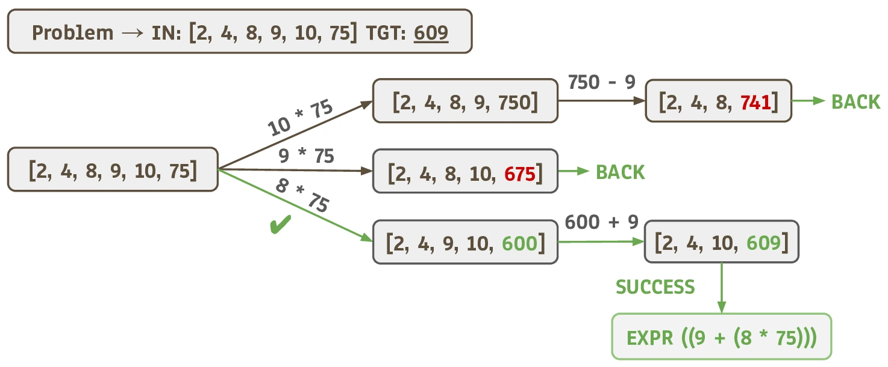

# ChainSearch


Code for **On Reasoning Correctness Directions**.

📄 **Paper:** [arXiv:XXXX.XXXXX](https://arxiv.org/abs/XXXX.XXXXX)

<p align="center">
  <a href="assets/chainsearch.pdf">
    
  </a>
</p>

## Overview

`ChainSearch` is a controlled arithmetic reasoning task designed to aid the study of chain-of-thought.

We adapt the well-known "Countdown numbers game"† by introducing a dedicated `BACK` token that makes backtracking explicit in reasoning traces.

We train a 3-million-parameter language model on ChainSearch samples generated using A* search with cost-function heuristics designed to mimic human foresight strategies.

Given a set of numbers and a target value, the objective is to construct an arithmetic expression that equals the target, using each supplied number at most once. The model must combine numbers to reach a target, explore alternative paths, and return to earlier states when it encounters dead ends.

† _Readers unfamiliar with Countdown can consult these mathematical analyses [[1]](https://doc.gold.ac.uk/aisb50/AISB50-S02/AISB50-S2-Colton-paper.pdf), [[2]](https://easychair.org/publications/paper/2L76), [[3]](https://arxiv.org/abs/2508.02900), or watch a demonstration [[4]](https://www.youtube.com/watch?v=pfa3MHLLSWI&t=3s)._

## Running the Experiments

Start by cloning the repository:

```bash
git clone https://github.com/samunaai/chainsearch.git
cd chainsearch
```

The main command flow is provided in [`commands.sh`](commands.sh). Refer to this file for the commands used to run the experiments.

<!-- TODO: Add environment setup and step-by-step instructions from commands.sh. -->

## Citation

If you use this work, please cite our paper:

<!-- TODO: Replace this placeholder with the arXiv BibTeX entry once available. -->

**On Reasoning Correctness Directions.** 2026. arXiv:XXXX.XXXXX.
